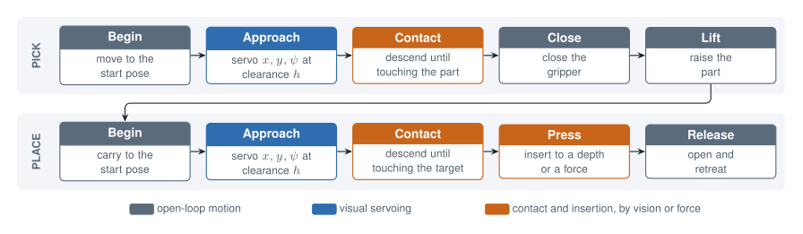
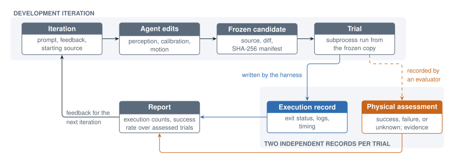

# Auto-Insert

**A Task Template and Development Harness for Agent-Written Robot Insertion Programs**

When general-purpose coding agents develop contact-rich manipulation software from an empty directory over hours of robot rollouts, they tend to collapse approach, alignment, contact, and recovery into a single monolithic script, rely on brittle hand-tuned image thresholds, and scatter self-imposed runtime assertions that abort viable trajectories.

**Auto-Insert** provides a concise, transparent Python codebase for stereo-guided pick-and-insert tasks that both coding agents and human engineers can read, audit, and tune stage by stage. It consists of three parts:

1. **Stage-Structured Task Template** (`pick/`, `place/`, `main.py`, `rollout.py`) — Expresses pick and place as five plain, sequential stage methods per phase (~200 lines per motion file) without a state-machine DSL, decoupling occlusion-tolerant stereo perception, taught local Jacobian calibration, and visual or force-guarded motion.
2. **Execution Contract** ([`AGENTS.md`](AGENTS.md)) — Engineering rules loaded at session startup that direct perception toward GPU-appropriate pretrained vision models and visible rigid landmarks near occluded sockets, prohibit unrequested runtime abort gates, treat transient missed detections as recoverable waits, and require phase-specific force-signal validation before closing a force loop.
3. **Development Harness** (`experiments/`) — Versions iterative edits into SHA-256 verified candidate snapshots, launches trials from frozen code copies, and records independent physical assessments separately from process exit codes.



---

## Repository Structure

| Path | Responsibility |
| --- | --- |
| `pick/perception.py`, `place/perception.py` | Task feature detection, stereo residual assembly, and background vision thread for force contact |
| `pick/calibration.py`, `place/calibration.py` | Taught alignment references, scaled ridge-regression Jacobian fitting, and four-axis motion updates |
| `pick/motion.py`, `place/motion.py` | Five inline stage methods per phase, visual servoing loops, continuous force descent, and workspace bounds |
| `main.py` | Phase sequencing (`run()`) and standalone kinematic demonstration devices |
| `rollout.py` | Transparent adapter recording (`RolloutLog`), synchronized stereo frame archiving, and source snapshots |
| `experiments/` | Iteration snapshotting (`run.py`), independent physical outcome recording (`evaluate.py`), and summary reporting (`report.py`) |
| `AGENTS.md` | Staged implementation SOP and execution/recovery contract for coding agents |
| `tests/` | Regression suite covering the execution contract, visual retries, concurrent force contact, logging, and frozen trials |

---

## Quick Start

Requires Python 3.10+ and NumPy.

```bash
python -m venv .venv
.venv/bin/pip install -e .

# Run the kinematic pick-and-insert pipeline
.venv/bin/python main.py

# Exercise feedback loops under Jacobian mismatch (up to 15%), perspective scale change,
# Gaussian feature noise, 15% frame dropout, and 10 ms capture latency
.venv/bin/python main.py --disturbed --seed 0

# Run the 31-test regression suite
.venv/bin/python -m unittest discover -s tests -v
```

`main.py` executes the ten-stage sequence against synthetic kinematic devices and writes paired rollout logs under `pick/data/rollouts/<rollout_id>/` and `place/data/rollouts/<rollout_id>/`:

```text
pick:   begin → approach → contact → close → lift
place:  begin → approach → contact → press → release
```

---

## 1. Device Interfaces and Coordinates

Visual alignment and taught calibration act in four coordinates in the robot base frame (`+z` pointing upward):

$$
q = [x, y, z, \psi]^\top \in \mathbb{R}^4
$$

Positions are in **millimeters** and Euler angles (`roll`, `pitch`, `yaw` $\psi$) are in **radians** using the **ZYX** convention (`Pose` in `pick/motion.py`). Each phase uses a nominal `roll` and `pitch` during visual alignment, while orientation adjustments in `roll`, `pitch`, or `yaw` remain available during `place.press()`.

Connecting a physical robot or simulator requires two lightweight adapter objects:

| Method | Contract |
| --- | --- |
| `robot.pose()` | Return the measured TCP `Pose` in the base frame |
| `robot.move(target, speed_mm_s, wait=True)` | Move to `target` at translational path speed `speed_mm_s`; `wait=True` blocks until arrival, `wait=False` updates the active target in flight and returns immediately |
| `robot.gripper(closed)` | Synchronously actuate the gripper (`True` closes, `False` opens) |
| `robot.wrench()` | Return base-frame TCP `[Fx, Fy, Fz, Tx, Ty, Tz]` in N and Nm (required when `contact(mode="force")` is enabled; upward environment-on-tool reaction force is `+Fz`) |
| `camera.capture()` | Return synchronized `(left_image, right_image)` arrays |

### Optional Workspace Bounds

`PickMotion` and `PlaceMotion` accept an optional `workspace_mm=((x_min, y_min, z_min), (x_max, y_max, z_max))` tuple in base-frame millimeters (using `±np.inf` for unconstrained sides) when the device or task contract specifies physical limits such as tabletop clearance. Targets outside declared bounds raise `pick.motion.WorkspaceLimit` before reaching the SDK, and an active force descent first commands a hold at the measured pose. By default (`workspace_mm=None`), the template imposes no bounds of its own.

---

## 2. Stereo Observation

A task-specific `detect(image)` callable maps each stereo view to named oriented landmarks `[u_px, v_px, theta_rad]`, where `theta_rad` is a directed $2\pi$-periodic image-plane angle and identical keys in the left and right views denote the same physical landmark:

```python
# Pick detector output
{"tool": [u_px, v_px, theta_rad], "object": [u_px, v_px, theta_rad]}

# Place detector output (or custom target_key for an unoccluded fixture landmark)
{"object": [u_px, v_px, theta_rad], "socket": [u_px, v_px, theta_rad]}
```

Given tool landmark $a$ and target landmark $b$, `observe()` stacks the left and right target-minus-tool residuals with angular differences wrapped to $[-\pi, \pi)$ as follows:

$$
f = [u_b^L - u_a^L, v_b^L - v_a^L, \mathrm{wrap}(\theta_b^L - \theta_a^L), u_b^R - u_a^R, v_b^R - v_a^R, \mathrm{wrap}(\theta_b^R - \theta_a^R)]^\top \in \mathbb{R}^6
$$

```python
from pick.perception import PickPerception
from place.perception import PlacePerception

pick_perception = PickPerception(camera, detect_pick)
place_perception = PlacePerception(camera, detect_place, target_key="fixture_landmark")
```

- **Occluded sockets:** Because the held part or gripper fingers commonly hide the socket right before touch-down, `target_key` can track any nearby landmark on the same rigid fixture (e.g., an adjacent housing edge or lens pair) that remains visible in both views. Teaching the reference $f_\star$ at the true insertion-entry pose absorbs the fixed spatial offset, so $f_\star$ is nonzero in general.
- **Model-based detection:** Core detectors should be built on GPU-appropriate pretrained segmentation, keypoint, or correspondence models rather than standalone hand-tuned color masks, Otsu thresholds, or contour heuristics. OpenCV may be used for preprocessing, camera geometry, and geometric post-processing of model outputs.
- **Transient misses:** If a frame is dropped, blurred, occluded, or non-finite, `detect()` or `observe()` returns `None` (or raises `pick.perception.ObservationUnavailable` for transient inference/capture errors). Visual loops command no motion, reset their consecutive-alignment counter, and acquire a fresh stereo pair. Genuine hardware, SDK, or programming exceptions are never suppressed.

---

## 3. Taught Local Jacobian Calibration

`pick` and `place` maintain separate calibrations in `pick/calibration.py` and `place/calibration.py`. Their taught references $(q_\star, f_\star)$ are the **aligned grasp pose right before closing** and the **insertion-entry pose right before pressing** (taught while holding the actual part).

1. Position the robot at the reference alignment and record `q_ref = robot.pose().q()` and `f_ref = perception.observe()`.
2. Sample at least eight signed perturbations along `x`, `y`, `z`, and `yaw` around `q_ref` (plus working-range poses near approach and entry), recording `sample_q` and `sample_features`.
3. Fit and persist the scaled local Jacobian $\Delta f \approx J \Delta q$ (optionally regularized toward a finite-difference geometric prior from `from_projection(q_ref, project)`):

```python
from pick.calibration import PickCalibration
from place.calibration import PlaceCalibration

pick_cal = PickCalibration.fit(q_ref, f_ref, sample_q, sample_features)
assert pick_cal.jacobian_rank() == 4
pick_cal_path = pick_cal.save()
```

At run time, `calibration.correction(features)` solves for the four-axis corrective step $\delta q = [\delta x, \delta y, \delta z, \delta \psi]^\top$ toward $(q_\star, f_\star)$. Saved JSON files store the reference, raw perturbation samples, normalization scales, optional prior, fitted Jacobian, normalized training RMSE (`fit_rmse`), and `jacobian_rank`. Always verify correction direction and magnitude on held-out perturbations before closed-loop execution.

---

## 4. Stage Control and Force Validation

Instantiate `PickMotion` and `PlaceMotion` with their calibrated models and initial poses, tune stage parameters per task, and run the complete workflow via `main.run()`:

```python
from main import run
from pick.calibration import PickCalibration
from place.calibration import PlaceCalibration
from pick.motion import PickMotion
from place.motion import PlaceMotion

pick = PickMotion(robot, pick_perception, PickCalibration.load(pick_cal_path), pick_begin)
place = PlaceMotion(robot, place_perception, PlaceCalibration.load(place_cal_path), place_begin)

result = run(pick, place, label="task-name")
```

### Stage Defaults and Completion Criteria

| Stage | Default Behavior and Completion Condition |
| --- | --- |
| `begin()` | Move to the phase's `begin_pose` at 20 mm/s; `pick` opens the gripper, `place` keeps it closed |
| `approach(clearance_mm=25.0)` | Move `clearance_mm` above the predicted target pose, then servo `x`, `y`, `yaw` at fixed height until 3 consecutive observations stay within 0.3 mm planar and 0.01 rad yaw error |
| `contact(mode="vision")` | Apply damped blocking four-axis steps (`0.5 * error`) until 3 consecutive observations meet 0.3 mm planar, 0.25 mm vertical, and 0.01 rad yaw tolerances (checking feature consistency when rank-deficient) |
| `contact(mode="force")` | Stream non-blocking targets 0.5 mm below the measured `z` at 1.0 mm/s while polling `robot.wrench()` every 20 ms; a background vision thread updates the `(x, y, yaw)` setpoint once per completed frame without stalling descent; hold the current pose immediately when `Fz >= 5.0` N |
| `close()` / `lift(height_mm=30.0)` | Close the gripper synchronously, then lift `height_mm` along `+z` |
| `press(depth_mm=3.0, inserted=None)` | Advance in 0.25 mm steps at 1.0 mm/s, alternating $\pm 0.04$ rad yaw twists by default before restoring the entry orientation (task subclasses may command roll/pitch adjustments or force stops); stops early if `inserted()` returns `True` |
| `release(height_mm=30.0)` | Open the gripper and retreat `height_mm` along `+z` |

### Force-Feedback Routes and Pre-Use Validation

Three routes can supply `robot.wrench()`:
1. **Wrist force/torque sensor** calibrated, zeroed, and transformed to the base-frame TCP.
2. **Model-based joint-torque estimation** subtracting modeled gravity torques $g(\theta)$ from motor torque readings $\tau$ and solving $\hat{w} = (J_\theta^\top)^\dagger (\tau - g(\theta))$ via damped least squares (`pick.motion.wrench_from_torques()`).
3. **Measured-baseline subtraction** recorded under matched tool, grip, payload, and pose conditions.

Before enabling `mode="force"` in either phase, measure stationary noise, free-motion transients at the actual approach/descent speed and payload, and contact/release repeatability. Evaluate `pick` and `place` separately—empty-gripper stability does not imply loaded stability. When free-motion transients overlap contact forces, drop force mode for that phase rather than inflating the force threshold.

### Execution Contract Summary

Read [`AGENTS.md`](AGENTS.md) before adapting the template. Task subclasses and SDK adapters follow the same runtime rules:

| Condition | Required Runtime Behavior |
| --- | --- |
| SDK finishes an open-loop move and reports a diagnostic residual | Log the residual and let the next feedback stage correct it; add no extra arrival assertion |
| Visual feature is missing on a frame or raises `ObservationUnavailable` | Command no move, reset consecutive alignment count, and capture a fresh stereo pair without an arbitrary retry cap |
| Force descent waits on slow or missing vision | Keep descending and polling force using the last `(x, y, yaw)` setpoint; never block force polling on camera/inference |
| Evaluation time target or post-rollout acceptance check fails | Record as an experiment outcome for the next iteration; do not wire evaluation targets in as runtime cutoffs unless required by the task/device contract |
| Declared `workspace_mm` exceeded | Raise `WorkspaceLimit` before sending the target (after holding the measured pose during active force descent) |
| Hardware/SDK fault or user interrupt | Hold pose if descending in force mode, preserve logs, and propagate the exception immediately |

---

## 5. Rollout Logging and Data Inspection

`RolloutLog` wraps `robot`, `perception`, `calibration`, and `camera` inside a `with` block using `Recorded` stand-ins that forward custom adapter attributes/methods transparently and restore the original objects on exit. While a stage runs, a `stage_diagnostic` heartbeat is logged every 5 s (`diagnostic_interval_s=5.0`) without interrupting motion.

A full run shares one `rollout_id` across `pick/data/` and `place/data/`:

```text
<phase>/data/
  calibrations/<id>.json            Saved Jacobian model, reference, scales, and raw samples
  rollouts/<rollout_id>/
    events.jsonl                    Ordered stage, observation, detection, correction, and SDK events
    frames/000001.npz               Compressed synchronized left/right stereo frames
    calibration.json                Exact calibration copy active during the rollout
    source/                         Snapshot of phase modules, main.py, rollout.py, and AGENTS.md
    result.json                     Execution status, final stage, and traceback if failed
```

Inspecting a recorded rollout in Python:

```python
import json
from pathlib import Path
import numpy as np

run_dir = Path("pick/data/rollouts") / result["rollout_id"]
events = [json.loads(line) for line in (run_dir / "events.jsonl").read_text().splitlines()]
stereo_pair = np.load(run_dir / "frames" / "000001.npz")  # stereo_pair["left"], stereo_pair["right"]
```

Standalone stage testing during calibration and tuning:

```python
from rollout import RolloutLog

with RolloutLog(pick, "pick", label="contact-tuning") as log:
    with log.stage("contact"):
        pick.contact(mode="force")
```

---

## 6. Development Harness (`experiments/`)



On physical and simulated robots, a zero exit code only indicates that the Python process finished—not that the parts are physically mated. The harness tracks iterative agent engineering at three nested levels (`experiment` → `iteration` → `trial`) and keeps **execution status** (`running`, `completed`, `failed`, `interrupted`) strictly independent of **physical outcome** (`success`, `failure`, `unknown`, or `not_evaluated`), which can be recorded by an automated sensor/geometry script, an independent vision-language evaluator agent, or a human observer.

### CLI Workflow

1. **Create an experiment** stating the task, agent, model, environment (`hardware`, `simulation`, or `kinematic_demo`), and physical acceptance criteria:

```bash
experiment_dir=$(python -m experiments.run create \
  --task usb-insertion \
  --agent codex \
  --model gpt-6-astra \
  --environment hardware \
  --criteria "Drive travels with gripper on lift, remains seated upright after release, finishes within 60 s.")
```

2. **Open an iteration** before editing code to snapshot the clean starting tree alongside `prompt.md` and `feedback.md`:

```bash
iteration_dir=$(python -m experiments.run start "$experiment_dir" \
  --prompt "$experiment_dir/prompt.md" \
  --feedback "$experiment_dir/feedback.md" \
  --hypothesis "Anchor place alignment on the visible top housing face.")
```

3. **Freeze the candidate** after editing to record the unified diff (`changes.diff`), `source_sha256.json` manifest, agent response, and optional `--usage` / `--trace` exports:

```bash
python -m experiments.run finish "$iteration_dir" \
  --response "$experiment_dir/response.md"
```

4. **Launch a hash-verified trial** in a subprocess rooted at the frozen candidate copy (sharing `CAP_ROLLOUT_ID` with `pick` and `place` logs):

```bash
trial_dir=$(python -m experiments.run trial "$iteration_dir" -- python main.py)
```

5. **Record an independent physical assessment** (via an automated check, evaluator agent, or human observer) with optional measurements and evidence images, then generate the experiment summary report:

```bash
python -m experiments.evaluate "$trial_dir" \
  --outcome success \
  --evaluator agent:coordinator \
  --evidence inspection.jpg

python -m experiments.report "$experiment_dir"
```

Summary reports compute the empirical success rate $S / (S + F)$ over assessed trials alongside explicit counts of `unknown` and `not_evaluated` runs so evaluation coverage $(S + F) / N$ stays transparent across iterations.

---

## Citation

```bibtex
@misc{zhao2026autoinsert,
  title   = {Auto-Insert: A Task Template and Development Harness for Agent-Written Robot Insertion Programs},
  author  = {Zhao, Shouzhi and Fan, Haoqiang},
  year    = {2026},
  url     = {https://github.com/ShouzhiZhao/Auto-Insert}
}
```
